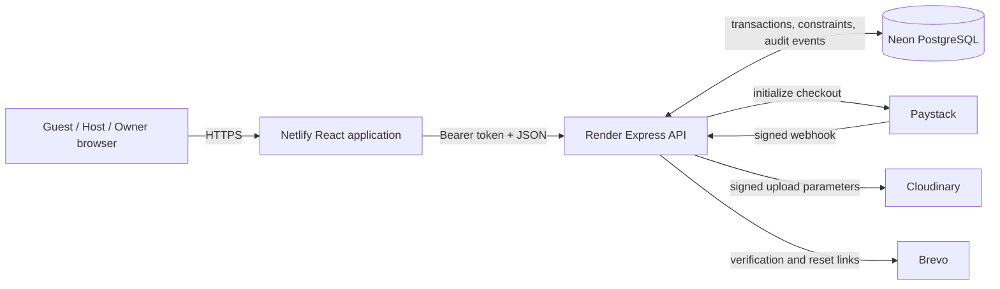
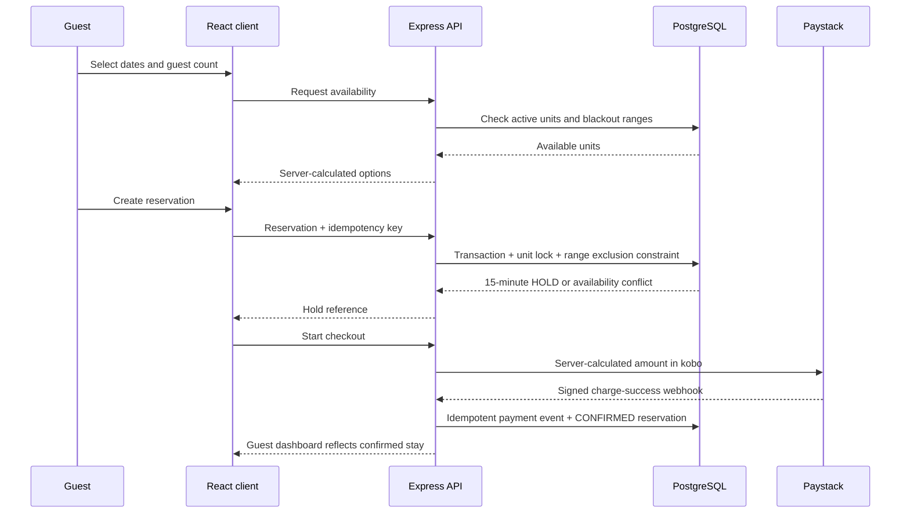

# ReserveFlow architecture

ReserveFlow is designed as a marketplace where browsers never decide availability, prices, booking status, or payment success. Those decisions belong to the API and PostgreSQL transaction boundary.

## Booking integrity

## Engineering guarantees

| Concern | Current control |
| --- | --- |
| Two guests try the same unit/dates | PostgreSQL range exclusion constraint and transactional locks |
| Browser retries booking/payment | Idempotency keys for reservations and payment checkout |
| Browser claims payment succeeded | Signed Paystack webhook is authoritative |
| Host changes public inventory | Listing returns to owner review before new discovery |
| Host attempts invalid stay action | Reservation state machine and Africa/Lagos date guards |
| Guest accesses another guest’s data | Bearer identity is derived server-side; guest routes filter by authenticated user |
| Support investigates a failure | `X-Request-Id` appears in response headers/errors and structured logs |

## Deployment responsibilities

- **Netlify:** Vite frontend and SPA fallback.
- **Render:** API process, protected environment variables, and health checks.
- **Neon:** relational source of truth, migrations, constraints, and audit records.
- **Paystack:** payment interface only; the webhook is the confirmation source.
- **Cloudinary:** property-image storage; only signed upload credentials reach approved hosts.
- **Brevo:** transactional delivery after domain authentication and account approval.

See [PROJECT_STATUS.md](../PROJECT_STATUS.md) for the current launch gate and externally dependent tasks.
